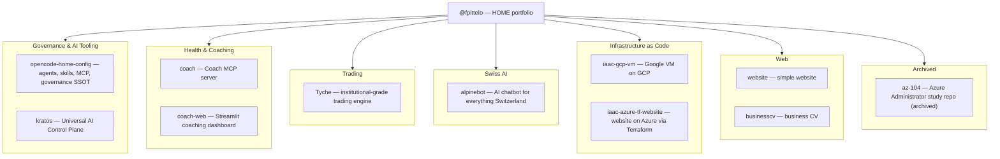

# Frederic Pitteloud — @fpittelo

Hi, I'm **Frederic Pitteloud** ([@fpittelo](https://github.com/fpittelo)) — my portfolio spans AI governance & tooling, health & coaching, trading, Swiss AI, infrastructure as code, and web, built around the HOME AI ecosystem.

## Portfolio map

## Projects

### Governance & AI Tooling

- [opencode-home-config](https://github.com/fpittelo/opencode-home-config) — HOME OpenCode configuration: personal AI agents, skills, MCP tools, and global profile (Golden Architecture v3.1).
- [kratos](https://github.com/fpittelo/kratos) — Universal AI Control Plane: a modular, vendor-agnostic control fabric enforcing a single Zero-Trust boundary across all LLM interactions (model routing, semantic governance, agent tool execution, financial control).

### Health & Coaching

- [coach](https://github.com/fpittelo/coach) — Coach MCP server: endurance-coaching backend for Intervals.icu analytics and structured training plans.
- [coach-web](https://github.com/fpittelo/coach-web) — Streamlit web app for the interactive Intervals.icu endurance coaching dashboard and weekly training plan visualization — Python-native frontend for the Coach MCP server.

### Trading

- [Tyche](https://github.com/fpittelo/Tyche) — institutional-grade trading engine pairing a sub-200 ms non-autoregressive reflex core with macro intelligence, locking alpha behind vault-grade security.

### Swiss AI

- [alpinebot](https://github.com/fpittelo/alpinebot) — AI-powered chatbot for everything Switzerland, presented with a minimalist and elegant design.

### Infrastructure as Code

- [iaac-gcp-vm](https://github.com/fpittelo/iaac-gcp-vm) — publish a Google VM on GCP.
- [iaac-azure-tf-website](https://github.com/fpittelo/iaac-azure-tf-website) — deploy a simple website on Azure with Terraform.

### Web

- [website](https://github.com/fpittelo/website) — simple website.
- [businesscv](https://github.com/fpittelo/businesscv) — my business CV.

### Archived

- [az-104](https://github.com/fpittelo/az-104) — Azure Administrator (AZ-104) study repo (**archived**).

---

*This profile repo is presentation-only; content evolves via direct update.*
